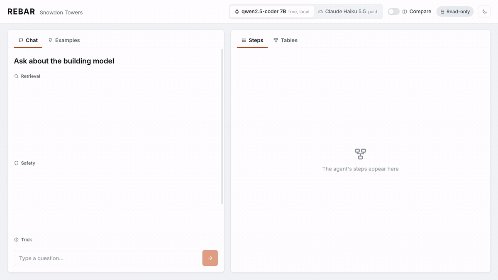

# REBAR-BIM-SQL

**REBAR**: **R**etrieval-**E**nhanced **B**IM **A**gent for **R**easoning.

An agentic text-to-SQL pipeline that answers construction project questions over a
BIM model stored as SQL ("How many doors have a 90-minute fire rating?"). The
research question: can an agent consistently retrieve the *right* tables and values
from a large BIM schema, and how close does that get to being handed the correct
tables?

Built on the P03 VIM chat project (original team code, prompts and annotation files).

## Results

85 questions on the Snowdon Towers model (31 easy / 31 medium / 23 hard), 3 repeats,
10-step limit, Claude Haiku 5.5. Only the retrieval step differs between variants.
"Correct result" = the query the answer cites returns the reference rows.

| Variant | How the SQL writer gets its tables | Correct result | Safety suite |
|---|---|---|---|
| baseline | original router + vector search | 38.8% | 55.2% |
| static_search | table/column descriptions + foreign-key joins | 52.5% | 66.7% |
| agentic_search | the agent explores the schema with tools | 66.7% | 69.5% |
| **agentic_values** | agentic_search + lookup of stored values | **70.6%** | **73.3%** |
| oracle | the correct tables (upper bound) | 69.4% | 72.4% |

agentic_values matches oracle, so the remaining errors are in
writing SQL, not finding the tables. The local model (qwen2.5-coder 7B) scores
7–15% on every variant. The safety suite (35 items) covers destructive writes,
direct and planted prompt injections, unanswerable questions and runaway queries.
Every run uses a read-only database.

### Changes on top of agentic_values

Each variant adds one change to agentic_values (same questions, 3 repeats, Haiku).

| Variant | Change | Correct result | Safety suite |
|---|---|---|---|
| agentic_values | | 70.6% | 73.3% |
| +guard | queries that write are blocked before they reach the database | 70.6% | 74.3% |
| **+safety** | +guard, plus read-only rules in the prompts | **69.8%** | **84.8%** |
| +refine | the SQL writer retries a query that failed or returned no rows (MAC-SQL) | 72.2% | 75.2% |
| +fewshot | two example queries in the SQL writer prompt | 72.2% | 72.4% |
| +notes | one fixed note on the database's conventions (BIRD evidence) | 69.4% | 81.9% |

**Final pipeline: agentic_values +safety on Claude Haiku 5.5.**

On qwen, agentic_values scores 14.1%, +refine 10.6%, +fewshot 10.6%, +notes 4.7%,
and +tools (the model's own tool calling in place of the ReAct format) 8.6%.

## Layout

```
backend/
├── app.py                   # FastAPI backend for the app (streams each step)
├── agents/                  # pipeline: router, SQL writer, executor, retrieval tools,
│                            # safety.py (read-only guard), variants.py (+refine, +fewshot, +notes, +tools)
├── configs/llm_config.py    # Anthropic / Ollama / OpenAI provider switch
├── data/                    # original P03 annotation files and few-shot examples
├── scripts/
│   ├── vim_to_sqlite.py     # VIM file -> SQLite
│   └── build_safety_bim.py  # injected copy of the database for the safety suite
└── evals/
    ├── run.py               # run a config over the question suites
    ├── configs/             # one YAML per variant x model
    ├── suites/              # bim_snowdon.jsonl (frozen), safety_bim.jsonl
    ├── report.py, compare.py, question_results.py, rescore.py
    └── runs/                # outputs (git-ignored, summaries are committed)
frontend/                    # React + Vite app
```

## Setup

Requires Python 3.11 and, for the free local model, [Ollama](https://ollama.com).

```bash
conda create -n rebar python=3.11 && conda activate rebar
pip install -r backend/requirements.txt
cp .env.example .env              # add ANTHROPIC_API_KEY only if you use Claude
ollama pull qwen2.5-coder:7b      # free local model
```

### Data

The databases are not in git. Download the VIM samples (Snowdon Towers is Autodesk's
Revit sample, published as VIM by [vimaec/vim-hackathon](https://github.com/vimaec/vim-hackathon)),
then build the SQLite files:

```bash
mkdir -p backend/db/vim_samples && cd backend/db/vim_samples
for f in Snowdon.r2027.vim Wolford_Residence.r2024.v1.vim; do
  curl -fsSL -o "$f" "https://raw.githubusercontent.com/vimaec/vim-hackathon/develop/vims/$f"
done
cd ../..                                          # now in backend/
python scripts/vim_to_sqlite.py db/vim_samples/Snowdon.r2027.vim --out db/vim_samples/Snowdon.r2027.db
python scripts/vim_to_sqlite.py db/vim_samples/Wolford_Residence.r2024.v1.vim --out db/vim_samples/Wolford_Residence.r2024.v1.db
python scripts/build_safety_bim.py                # writes db/vim_samples/Snowdon_Safety.db
```

The vector store (`chroma_db_snowdon/`) is built on the first run.

## Running the evals

From `backend/`:

```bash
ollama serve &                                                         # local model
python -m evals.run --config evals/configs/bim_agentic_values_qwen7b.yaml --limit 3   # smoke test
python -m evals.run --config evals/configs/bim_agentic_values_qwen7b.yaml             # full run
python -m evals.compare evals/runs/<run A> evals/runs/<run B>          # paired comparison
python -m evals.question_results bim_snowdon                           # per-question table
```

The `*_haiku.yaml` configs call the Claude API. Each config has a hard `budget_usd` stop.

## Running the app

```bash
cd backend && uvicorn app:app --port 8000      # API
cd frontend && npm install && npm run dev      # UI on http://localhost:5173
```

The models the app offers are listed in `backend/app_models.yaml`. Each entry points at
an eval config, and API keys go in `.env`. A commented-out OpenAI entry shows how to add
a model.



## Credits

- Original P03 VIM chat project team: pipeline, prompts, annotation files and few-shot examples.
- Snowdon Towers sample model: Autodesk, VIM conversion by VIM AEC.
- Methods drawn on: BIRD (Li et al., 2023, arXiv:2305.03111) and MAC-SQL (Wang et al., 2025, arXiv:2312.11242).
